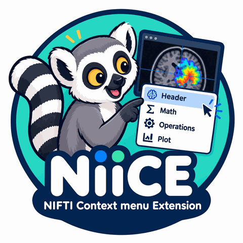
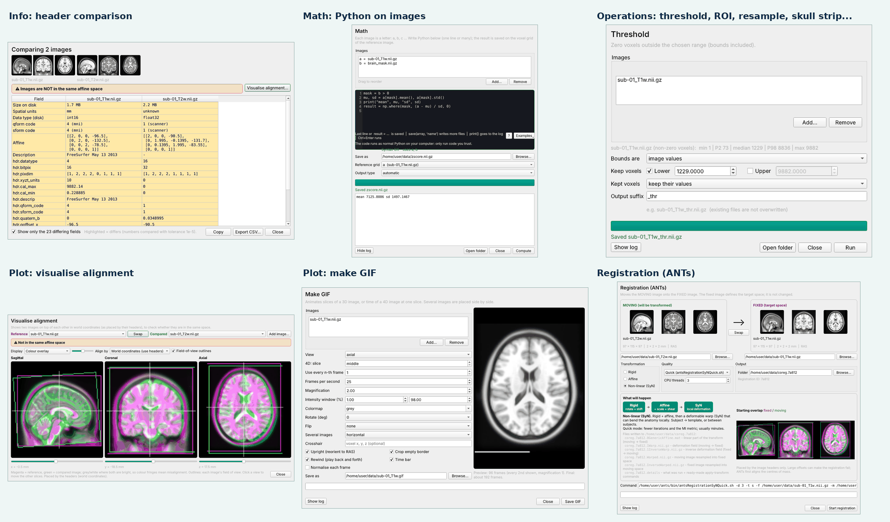

<p align="center"></p>

<p align="center"><b>NiiCE — NIfTI Context Extension</b><br>
Right-click a <code>.nii</code> / <code>.nii.gz</code> file and get quick neuroimaging tools.</p>



## Tools

| Menu | What it does |
|---|---|
| **Info** | Header and image properties; select several images to compare headers and check they share the same space |
| **Math** | Python/numpy code on images (`a`, `b`, …), from one-liners to pasted scripts |
| **Operations** | Binarise, threshold, extract ROI / volume, resample, subtract, skull strip (SynthStrip) |
| **Plot** | Animated GIF, intensity histogram, alignment overlay of two images |
| **Registration** | ANTs rigid / affine / SyN registration with a pre-run overview and progress bar; apply transforms |
| **Settings** | Choose which tools appear, colours, plugins |

## Install (Linux)

```bash
git clone https://github.com/tmspvn/NiiCE && cd NiiCE
./install.sh
```

The script installs NiiCE in its own environment (`~/.venvs/niice`), adds the `niice` command and
the right-click menu (Nautilus, Nemo, Caja, Thunar/XFCE, Dolphin). Run `./install.sh --help` for options and
`./install.sh --uninstall` to remove it. Registration needs [ANTs](https://github.com/ANTsX/ANTs)
on your `PATH`; everything else is included.

## Use

Right-click one or more NIfTI files → **NiiCE**, or from a terminal:

```bash
niice info sub-01_T1w.nii.gz sub-01_T2w.nii.gz
niice demo ~/niice_demo      # example images to try every tool
```

Own tools can be added as small Python plugins: see [`examples/plugins`](examples/plugins).

## License

[MIT](LICENSE). Please also cite the tools NiiCE runs: SynthStrip (Hoopes et al., *NeuroImage*
2022) and ANTs (Avants et al., *NeuroImage* 2011). Screenshots show the MNI152NLin2009cAsym
template from [TemplateFlow](https://www.templateflow.org).
